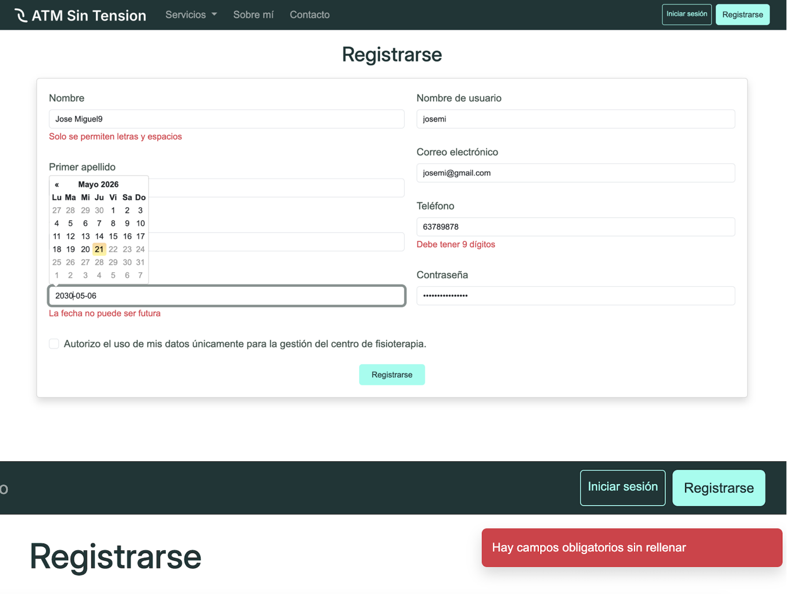
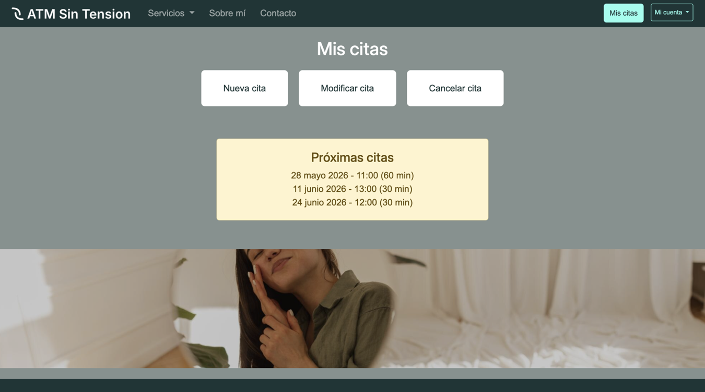
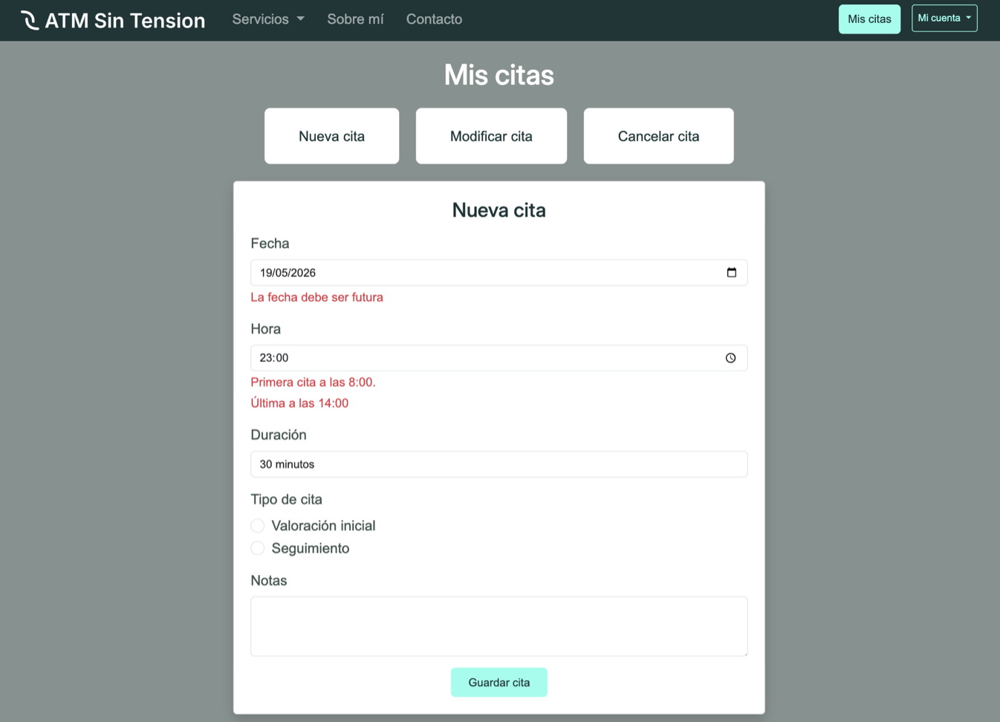
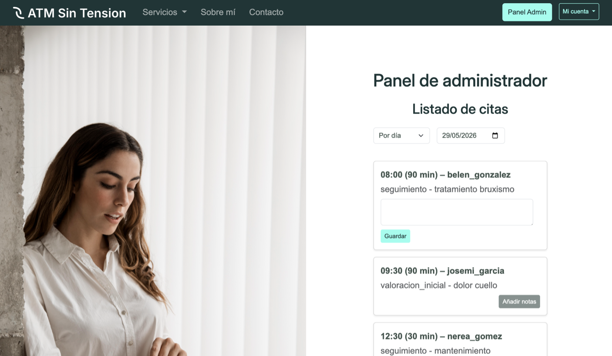
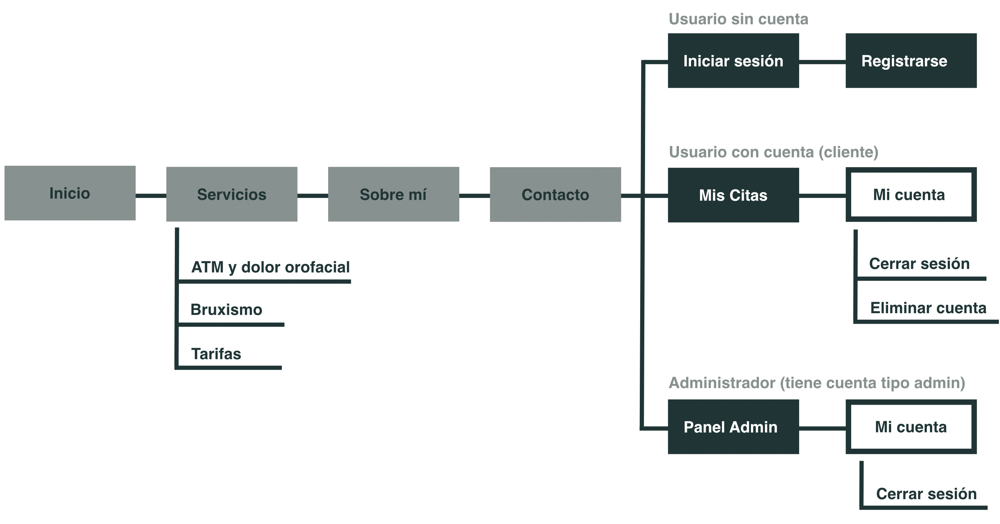

# ATM Sin Tensión — TFG DAW

Aplicación web para una clínica de fisioterapia especializada en ATM (articulación temporomandibular). Desarrollada como Trabajo Final de Grado del ciclo DAW.

Permite a los pacientes registrarse y gestionar sus citas online, y a la fisioterapeuta consulta su agenda desde un panel propio.

> ℹ️ La aplicación usa PHP y MySQL, así que no se puede ver directamente desde GitHub. Más abajo tienes capturas de las funcionalidades principales y las instrucciones para ejecutarla en local.


---

## Tecnologías

- **PHP 8** - lógica de servidor y procesamiento de formularios
- **MySQL** — base de datos (via XAMPP)
- **Bootstrap 5** — estilos y componentes
- **JavaScript** — validación de formularios en el cliente
- **jQuery** — usado para el datepicker

---

## Funcionalidades

### Usuarios no registrados
- Ver información de la clínica, servicios y contacto
- Registrarse e iniciar sesión

### Clientes (`tipo_usuario = 0`)
- Crear, modificar y cancelar citas
- Elegir fecha, hora, duración y tipo de cita

### Administrador (`tipo_usuario = 1`)
- Ver citas filtradas por día o por usuario
- Añadir notas internas a cada cita

---

## Capturas

### Zona pública

| Página de inicio | Registro con validación de errores |
|:---:|:---:|
|  |  |

### Área de pacientes

| Mis citas | Nueva cita |
|:---:|:---:|
|  |  |

### Panel de administración

| Citas por día, con notas | Citas por paciente |
|:---:|:---:|
|  |  |

### Mapa de navegación



---

## Estructura de carpetas

```
├── auth/               # Login, logout y eliminación de cuenta
├── dao/                # Acceso a la base de datos (dao.php)
├── db/                 # Conexión a MySQL
├── includes/           # Componentes reutilizables (navbar, header, footer, validaciones...)
├── public/             # CSS, JS e imágenes estáticas
└── *.php               # Páginas de la web
```

---

## Instalación local

1. Tener instalado **XAMPP** con Apache y MySQL activos.
2. Clonar el repositorio dentro de `htdocs/`:
   ```
   git clone https://github.com/blancabech/blancaTFG.git blancaTFG
   ```
3. Importar el archivo SQL de la base de datos en phpMyAdmin (base de datos: `atmsintension`).
4. Acceder en el navegador a `http://localhost/blancaTFG/`.